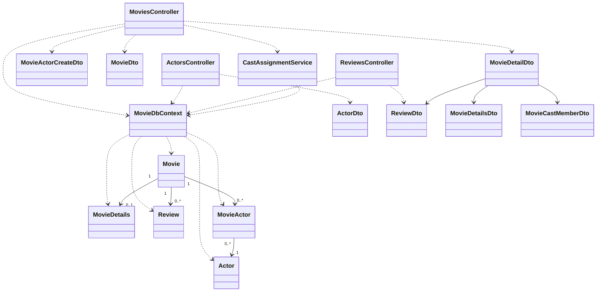

# MovieApi class diagram

Controllers project EF Core entities into response DTOs. The detail response composes separate DTOs for supplementary information, reviews, and cast. `MovieActor` represents the stored relationship, while `MovieCastMemberDto` exposes the actor profile and role for a particular movie.

[Controllers](https://github.com/RakivoJoy/ReEducation-MovieApi/tree/main/src/MovieApi/Controllers) · [DTOs](https://github.com/RakivoJoy/ReEducation-MovieApi/tree/main/src/MovieApi/DTOs) · [EF mappings](https://github.com/RakivoJoy/ReEducation-MovieApi/blob/main/src/MovieApi/Data/MovieDbContext.cs)
