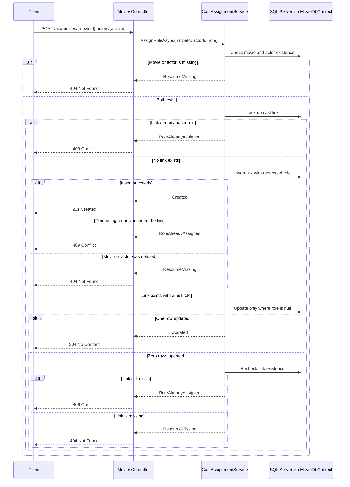

# Assign a role to a movie cast member

The diagram starts after request validation. The conditional update prevents a concurrent request from overwriting a role. When an insert races with another write, the service maps SQL Server's primary-key and foreign-key failures to the outcomes shown above.

[Controller](https://github.com/RakivoJoy/ReEducation-MovieApi/blob/main/src/MovieApi/Controllers/MoviesController.cs) · [Service](https://github.com/RakivoJoy/ReEducation-MovieApi/blob/main/src/MovieApi/Services/CastAssignmentService.cs) · [Integration tests](https://github.com/RakivoJoy/ReEducation-MovieApi/blob/main/tests/MovieApi.IntegrationTests/MoviesApiTests.cs)
