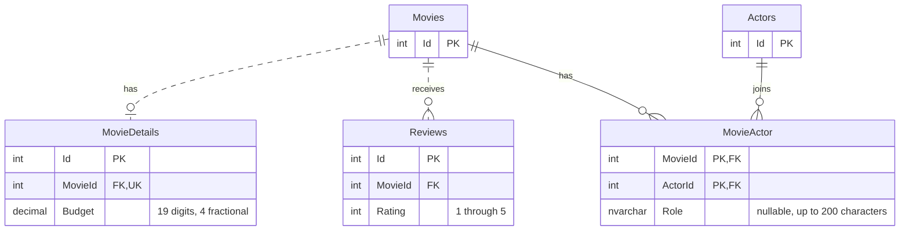

# SQL Server entity-relationship diagram

- Each details record belongs to one movie. A unique index on `MovieDetails.MovieId` limits each movie to one details record.
- A movie can have zero or more reviews. `CK_Reviews_Rating` enforces the inclusive range from 1 to 5.
- The composite key `MovieActor(MovieId, ActorId)` permits one link per movie and actor. A null role represents a link awaiting a role assignment.
- Deleting a movie cascades to its details, reviews, and cast links. Deleting an actor cascades to its cast links.

[SQL Server schema](https://github.com/RakivoJoy/ReEducation-MovieApi/blob/main/scripts/sql/movieapi-schema.sql) · [EF mappings](https://github.com/RakivoJoy/ReEducation-MovieApi/blob/main/src/MovieApi/Data/MovieDbContext.cs)
