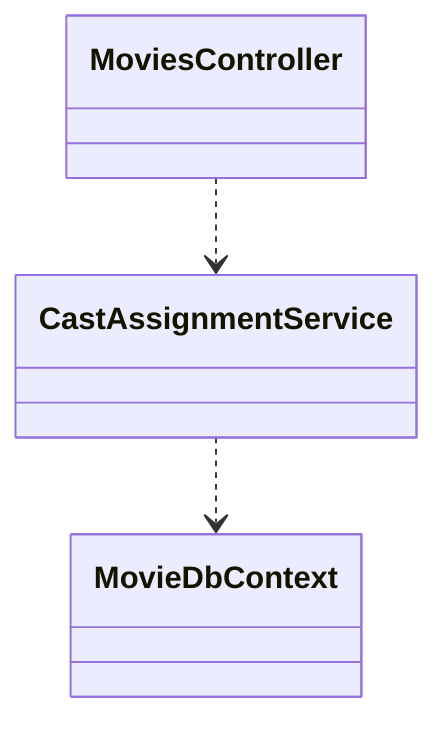
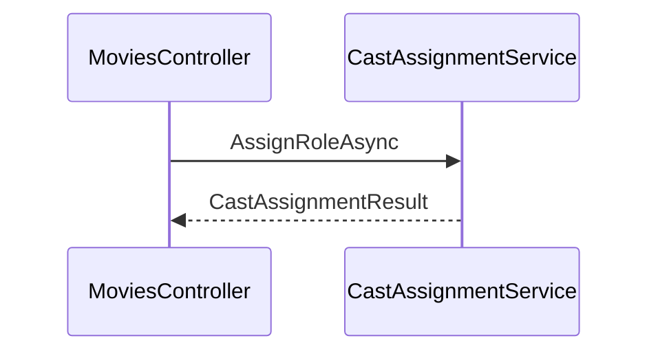
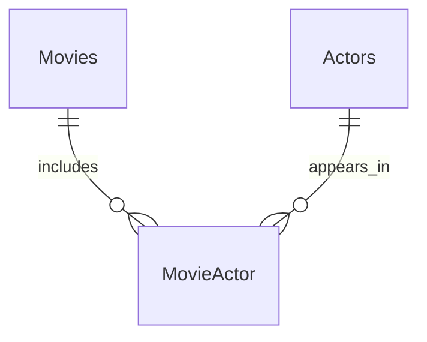

# Maintain Mermaid diagrams

Use fenced `mermaid` blocks. Choose a class diagram for type dependencies, a sequence diagram for call order, and an ER diagram for persisted relationships. DocFX uses the modern template to render these blocks.

Use names from the code or schema. In an ER diagram, `||` means exactly one and `o{` means zero or more. Put constraints that need prose beside the diagram. Link to the types, EF mappings, or schema used as evidence. When changing the implementation, review the matching labels, arrows, and cardinalities and preview the rendered diagram.
